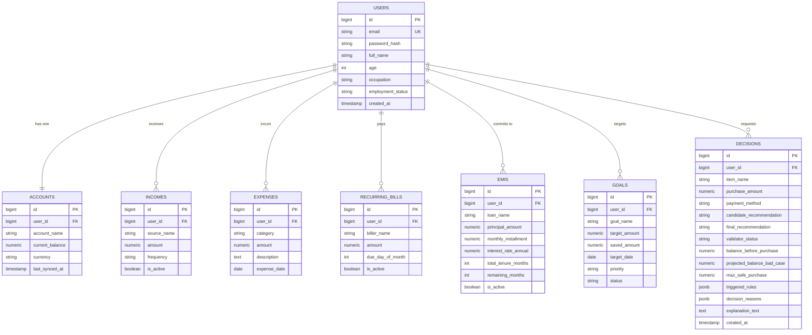

# FinSafe Database Architecture & Schema Documentation

[-3ECF8E.svg)](#design-rationale)
[](#entity-specifications)
[](#safety-rules-mapping)

This directory contains the complete database implementation for **FinSafe: AI Financial Decision Engine**. It includes the normalized relational schema, realistic synthetic seed data, analytical queries, and design documentation.

---

## 🏛️ Directory Structure

```
database/
├── README.md                      # Architecture guide, ERD, and evaluation notes (This file)
├── schema/
│   └── 01_init_schema.sql         # Production DDL: Tables, constraints, foreign keys, indexes
├── seed/
│   └── 02_seed_demo_data.sql      # Realistic personas (Safe, Over-leveraged, Deficit)
└── queries/
    └── 03_sample_analytics.sql    # Ready-to-demo queries for dashboards and Safety Validator
```

---

## 💡 Design Rationale (Why PostgreSQL / Supabase?)

| Criterion | Why PostgreSQL / Supabase is Chosen | Why Alternative Failed |
| :--- | :--- | :--- |
| **Financial Math Precision** | Uses `NUMERIC(14, 2)` to eliminate floating-point rounding errors in currency (INR/cents). | Standard floating-point types (`FLOAT`/`DOUBLE`) introduce precision loss in calculations. |
| **ACID Integrity** | Strict ACID compliance ensures transactions, EMI additions, and balance syncs never corrupt state. | Eventual consistency in pure NoSQL can cause balance discrepancies during simultaneous requests. |
| **Relational + JSONB** | Structured relational tables for users and finances, with `JSONB` for storing flexible AI decision rule audits. | Pure relational requires 5+ extra junction tables; pure NoSQL loses foreign key integrity. |
| **Team Collaboration** | Cloud-hosted with zero local setup. All 5 members instantly share the same database. | Local MySQL requires manual software installs and debugging port conflicts across 5 laptops. |

---

## 📊 Entity-Relationship Diagram (ERD)



---

## 📋 Entity Specifications & Rules Mapping

| # | Entity / Table | Primary Purpose | Safety Validator Rules Supported |
| :--- | :--- | :--- | :--- |
| **1** | `users` | User authentication, identity, and demographic profile | System Security & Ownership |
| **2** | `accounts` | Liquid balance tracking (`current_balance`) | **Rule V5 (Cash on Hand)**: Ensures cash covers upfront purchases |
| **3** | `incomes` | Regular income streams | **Rule V6 & V7**: Computes Debt-to-Income baseline |
| **4** | `expenses` | Categorized spending records for cashflow projections | **Rule V4 (Safety Buffer)**: Powers bad-case cashflow stress test |
| **5** | `recurring_bills`| Fixed monthly commitments (Rent, Subscriptions) | Fixed baseline calculations |
| **6** | `emis` | Active loan repayments and monthly installments | **Rule V7 (Existing Obligations)**: Aggregates total monthly debt burden |
| **7** | `goals` | Priority savings goals (Emergency Fund, etc.) | **Rule V8 (Goal Protection)**: Detects purchase-induced goal delays |
| **8** | `decisions` | Full historical audit trail of all purchase analyses | **Rule V9 (Audit Trail)**: Records candidate vs. final verdicts and reasons |

---

## 🎭 Synthetic Test Personas (Included in Seed Data)

To demonstrate how the system handles different financial profiles:

1. **Aarav Sharma (`aarav.sharma@example.com`) — Healthy / Safe Spender**:
   * Income: ₹1,35,000 | Balance: ₹2,50,000 | EMI: ₹10,000 | Surplus: +₹78,500
   * **Test Case**: A ₹25,000 desk purchase produces **`Buy Now`** (`PASS`).
2. **Priya Patel (`priya.patel@example.com`) — Stretched / High Debt Ratio**:
   * Income: ₹65,000 | Balance: ₹42,000 | Existing EMIs: ₹19,300 (30% DTI ratio)
   * **Test Case**: A ₹65,000 smartphone upfront purchase is modified to **`Wait`** (`MODIFY` via **V5 Cash on Hand** and **V4 Safety Buffer**).
3. **Rahul Verma (`rahul.verma@example.com`) — High Risk / Monthly Deficit**:
   * Income: ₹38,000 | Balance: ₹9,500 | Total Outlays: ₹40,000 (Monthly Deficit: -₹2,000)
   * **Test Case**: A ₹42,000 console purchase produces **`Not Recommended`** (`PASS` on rejection) because any spend breaches the minimum buffer.

---

## 🚀 How to Run in Supabase (3 Steps)

1. Open your project on **[supabase.com](https://supabase.com)** and go to the **SQL Editor** tab.
2. Open and execute:
   * **`schema/01_init_schema.sql`** (Creates all 8 tables, indexes, and constraints).
   * **`seed/02_seed_demo_data.sql`** (Populates the 3 test personas and records).
3. Run the analytical queries in **`queries/03_sample_analytics.sql`** to verify data calculations.

---

## 🎓 Teacher / Evaluator Q&A Cheatsheet

**Q1: Why did you choose PostgreSQL over MongoDB for a financial application?**
> *"Financial applications require strict ACID guarantees and foreign key integrity. PostgreSQL provides exact mathematical precision with the `NUMERIC` data type (preventing floating-point rounding bugs) and supports `JSONB` so we can store complex AI audit logs without losing relational constraints."*

**Q2: How does the database prevent orphaned records if a user is deleted?**
> *"All foreign key relationships on `user_id` specify `ON DELETE CASCADE`. If a user account is removed, all associated accounts, transactions, EMIs, goals, and decision histories are safely cleaned up automatically."*

**Q3: How does the database handle Safety Validator auditability?**
> *"In the `decisions` table, we store both the AI candidate output and the final validated verdict, along with `triggered_rules` and `decision_reasons` stored as native `JSONB`. This allows efficient querying and ensures complete audit transparency for every financial recommendation."*
